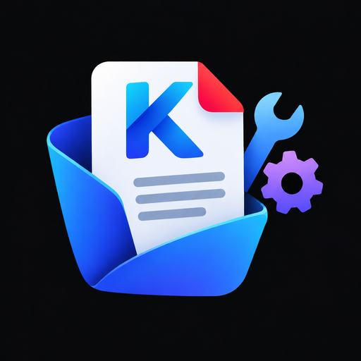

  

<h1 align="center">Kosh</h1>

  
  
  
  
  
  
  
  

  

## About

Kosh is an all-in-one document app for Android: scan paper into PDFs, read and organise the PDF, Word, Excel and PowerPoint files on your phone, edit PDFs with a set of tools, and keep notes you can have read aloud to you. Everything runs on the device. There is no account, no cloud upload and no internet needed for any of it.

## What it does

**Home**
- Finds the PDF, Word (.docx), Excel (.xlsx) and PowerPoint (.pptx) files on your phone and lists them in one place, by file or by folder, with a first-page preview for PDFs.
- Search by file name or folder.
- Tap a Word, Excel or PowerPoint file to read it in the built-in reader. Its 3-dot menu has **Save as PDF**.
- Press and hold to pick several files, then share, merge or delete them.
- Share, rename and delete from the 3-dot menu.

**Scanner**
- Scan with the camera or import photos from the gallery.
- Crop with perspective correction and pick a filter: Original, Document, Grayscale, Black and white or Color.
- Save as a compact PDF, with a choice of paper size, orientation and quality.

**PDF tools**
- Merge, split, extract pages, delete pages, rotate and reorder pages.
- Add page numbers, compress, and encrypt or decrypt with a password.
- Convert PDF pages to images (JPG or PNG).
- Convert images to PDF.
- Convert Word files to PDF, pictures included.
- **Pages per sheet**: put 2, 4, 6, 9 or 16 pages on one sheet, in portrait or landscape, with optional page borders of an adjustable width.

**Notes**
- Write with Markdown formatting: bold, italic, strike-through, headings, bullet and numbered lists, and tick-box checklists, shown as you type.
- Add pictures inside a note.
- Pin, archive, duplicate and move notes to the trash.
- Export or share as PDF, Markdown or plain text.
- **Read aloud**: pick any voice installed on your phone and the reading speed. The word being read is highlighted and the note scrolls along. A small bar at the bottom lets you pause, stop and change speed.

## Privacy

Your files stay on your phone. Kosh does not need an account and does not collect or send your documents anywhere.

## Download

Get the latest APK from the [Releases page](https://github.com/karthikhegde25/Kosh/releases). On the first install Android may ask you to allow installing apps from your browser or file manager.

Kosh asks for access to your files so it can list the documents on your phone, and for the camera only when you scan.

## Built with

- Kotlin and Jetpack Compose (Material 3)
- [PdfBox-Android](https://github.com/TomRoush/PdfBox-Android) for the PDF tools
- [PDF.js](https://mozilla.github.io/pdf.js/) for reading PDFs
- CameraX for scanning
- GitHub Actions for builds

Requires Android 8.0 (API 26) or newer.
